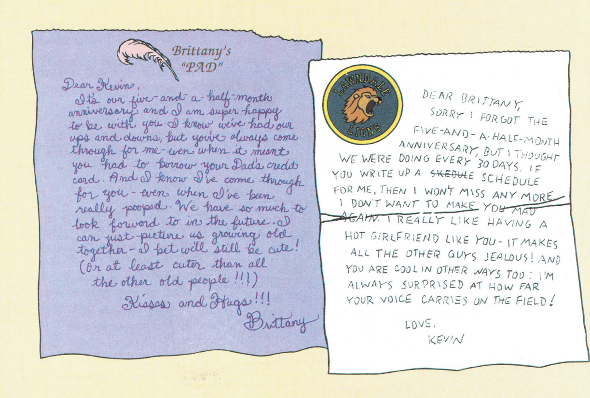
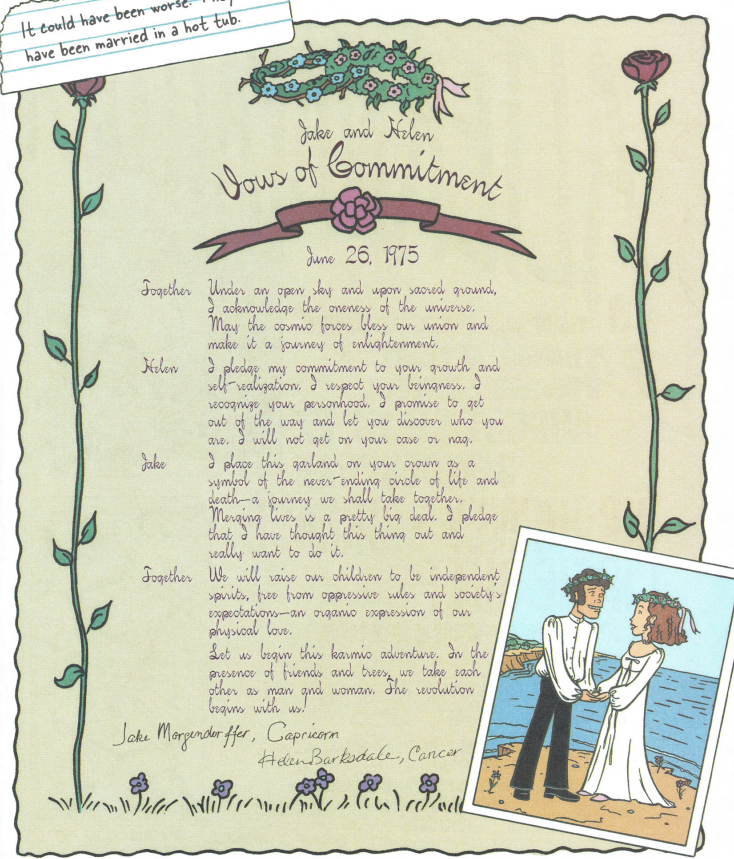

   # Chat with Your PDF: Local RAG

   Upload a PDF, ask questions about it, and get answers with page sources. Everything runs locally: OCR with Chrome's built-in engine, embeddings and answers with Ollama, and storage in Chroma. No API keys and no cloud calls.

   Tested on Windows with Python 3.14. Scanned and image-only PDFs are supported, which was the original motivation for the project. The Daria Diaries PDF, for example, has no text layer, colorful pages, and decorative fonts.

   ## How It Works

   1. **Upload:** The PDF is saved in `data/`.
   2. **OCR:** `vellum` runs Chrome's Screen AI OCR engine on the pages in parallel page ranges. The text goes to `data_text/`, with pages separated by form-feed characters so page numbers survive. If a text file already exists for the PDF, this step is skipped.
   3. **Chunking:** Pages are split into 800-character chunks with 80 characters of overlap.
   4. **Embedding:** Chunks are embedded with `nomic-embed-text` through Ollama and stored in Chroma, using one collection per PDF.
   5. **Question answering:** The question is expanded into a few search queries by the LLM. Retrieval combines vector search and BM25 keyword search using reciprocal rank fusion. The top chunks are passed to the answer model, and the reply streams into the chat with a Sources list.

   ## Requirements

   Install the following before setting up the application. These dependencies cannot be installed with pip.

   ### 1. Python

   - Python 3.14 (other versions are untested).

   ### 2. Ollama

   Install Ollama and pull the required models:

   ```bash
   ollama pull nomic-embed-text
   ollama pull llama3.1:8b
   ```

   Any chat model works; select it from the dropdown in the app. On a 6 GB GPU, `llama3.2:3b` is faster.

   ### 3. .NET and Vellum

   Install the .NET 9 SDK, then install the OCR tool:

   ```powershell
   winget install Microsoft.DotNet.SDK.9
   dotnet tool install -g Ocr.Vellum.Cli
   ```

   ### 4. Google Chrome

   Install Google Chrome and ensure the Screen AI component is downloaded. Check `chrome://components`.

   Opening a scanned PDF in Chrome once triggers the download.

   ## Setup

   Create and activate a virtual environment, then install the Python dependencies:

   ```powershell
   python -m venv venv
   venv\Scripts\activate
   pip install -r requirements.txt
   ```

   ## Run

   Start Ollama first using the tray app or by running `ollama serve`. Then launch Streamlit:

   ```bash
   streamlit run app.py
   ```

   Open the URL printed in the terminal, usually [http://localhost:8501](http://localhost:8501).

   In the sidebar:

   1. Drop in a PDF.
   2. Click **Process this PDF**.
   3. Wait for processing to finish.
   4. Select the document from the **Document to chat with** list.
   5. Start asking questions.

   ## Notes on Behavior

   - **Duplicate uploads:** Uploading a PDF whose name already exists is refused. Delete the old one first using **Delete this document**.
   - **Incomplete processing:** PDFs that did not finish processing appear under **PDFs not fully processed**, where you can process or delete them.
   - **Locked controls:** Controls are locked while a PDF is processing.
   - **Logs:** Progress and errors are printed in the terminal and saved to `logs/app.log`. Each OCR part also writes its own log to `logs/`.

   ## Why Chrome's OCR

   Plain text extraction does nothing for this kind of PDF because every page is an image. The first task was finding an OCR engine capable of reading it.

   The pages are challenging: colored backgrounds, text over graphics, and decorative, handwriting-style fonts. These are stylized typefaces, not real pen handwriting.

   ### Engines compared

   The following engines are supported by `test_extractors.py`, which extracts text from a few random pages and prints the text and processing time per page.

   | Engine | Description |
   |---|---|
   | `pypdf` | Embedded text layer only, through PyMuPDF. No OCR, so it returns nothing for scanned PDFs. Used as a baseline to confirm the PDF needs OCR. |
   | `tesseract` | Classic open-source engine. Strong on clean printed text, but expects plain black-on-white pages and has no handling for busy backgrounds or stylized fonts. Results on the Daria pages were poor, even at 300 DPI. |
   | `winocr` | Built-in Windows OCR. Also gave poor results on the Daria pages. |
   | `rapidocr`, `easyocr`, `paddleocr` | Lightweight deep-learning OCR libraries. Included in the script but not part of the comparison below. PaddleOCR did not install on Python 3.14 because PaddlePaddle has no build for it. |
   | `ollama` | A local vision model, such as `qwen2.5vl:7b`, that reads the page image. Included in the script but not part of the comparison below. |
   | **Chrome Screen AI** | Chrome's built-in OCR. Not a pip package. It is the on-device machine learning model Chrome uses to make scanned PDFs selectable. Chrome's PDF viewer read the decorative fonts correctly, and `vellum` loads the same engine without a browser window. This is the engine used by the app. |

   ### Results

   The pages combine colored backgrounds, text over graphics, and decorative handwriting-style fonts. Tesseract and Windows OCR both struggled with this combination and returned garbled or incomplete text. Chrome's OCR was the only engine I tried that read these pages and fonts reliably.

   That is why the pipeline uses Chrome's engine through `vellum`.

   ### Used PDF's links, download and add into books/ folder in docs or data/ folder
   - [The Daria Diaries PDF](https://archive.org/details/dariadiaries0000bern)
   - [The Daria Database PDF](https://pdfcoffee.com/daria-database-ordartzpdf-2-pdf-free.html)

   ### What the pages look like

   
   

   
   ## OCR Engine Testing

   I tested multiple OCR engines on page 36 of *The Daria Diaries* PDF to compare their ability to recognize text from a scanned page with a decorative, handwritten-style font.

   **Test document:** `pdfcoffee.com_the-daria-diaries-ordartzpdf-pdf-free.pdf`  
   **Page:** 36 of 80  
   **Rendering resolution:** 300 DPI

   
   ### Why Page 36?

   Page 36 was specifically selected because its font is unusually handwritten in appearance, decorative, and difficult to read even for a human. This makes it a challenging test case for OCR systems, particularly when distinguishing similar-looking characters and reconstructing words from unusual letter shapes.

   Rather than testing only on clean, easily readable text, this page provides a more demanding comparison of how well different OCR engines handle difficult typography. The goal is to identify which engine can recover the most readable and faithful transcription under these conditions.


   ### Results

   | OCR Engine | Extracted Characters | Processing Time |
   |---|---:|---:|
   | Chrome Screen AI (Vellum) | 1,125 | 264.1 s |
   | EasyOCR | 1,031 | 37.1 s |
   | Tesseract PSM 11 | 547 | 5.5 s |
   | RapidOCR | 318 | 36.6 s |
   | Windows OCR | 245 | 3.4 s |
   | Ollama Vision (Qwen 2.5 VL 7B) | 85 | 36.9 s |
   | Tesseract PSM 3 | 51 | 6.5 s |
   | PyMuPDF text extraction | 0 | 0.0 s |

   *Processing times are from a single run on the local machine and may vary between runs.*

   ### Best Result: Chrome Screen AI OCR

   Chrome Screen AI OCR, accessed through Vellum, produced the best-matching transcription in this test. Its output serves as the reference for comparing the other engines.

   Although EasyOCR produced a similar amount of text in considerably less time, its transcription contained substantial character recognition errors. The other engines generally missed more text or produced less readable output.

   ### Transcription Comparison

   The following examples illustrate the differences observed in the outputs.

   **Chrome Screen AI OCR — Reference**

   Used as the reference transcription for the other OCR engines. Its output contained the most useful reconstruction of the page among the tested engines.

   **EasyOCR**

   Example output:

   ```text
   They tould worse: tould have been hot tub: married in & have been
   ```

   The output contains misrecognized words, incorrect characters, and garbled text. Despite producing 1,031 characters, its transcription was not consistently readable.

   **Ollama Vision (Qwen 2.5 VL 7B)**

   Example output:

   ```text
   It could have been worse. They could
   have been married in a hot tub.
   Jake and Helen
   ```

   The model correctly reconstructed a recognizable passage, including the dialogue and character names, but returned only 85 characters overall. This suggests that it captured a small portion of the page rather than transcribing the entire page.

   **RapidOCR**

   The output contained fragments of recognizable words and names, but much of the text was missing or incorrectly recognized.

   **Tesseract PSM 3 and PSM 11**

   Both configurations struggled with the decorative font. PSM 3 returned very little text, while PSM 11 extracted more content but still produced substantial recognition errors and garbled output.

   **Windows OCR**

   Windows OCR returned some recognizable fragments but failed to reconstruct most of the page's text accurately.

   **PyMuPDF Text Extraction**

   Returned an empty string because the scanned page contains an image rather than an embedded text layer. This is an expected result, not an OCR failure.

   ### Findings

   - **Best matching transcription:** Chrome Screen AI OCR.
   - **Fastest OCR engine in this test:** Windows OCR, at 3.4 seconds, although its transcription quality was poor.
   - **Promising speed-to-output alternative:** EasyOCR, which extracted 1,031 characters in 37.1 seconds but produced substantial recognition errors.
   - **Vision-language model:** Qwen 2.5 VL 7B recovered a recognizable passage but did not transcribe the entire page.
   - **Main challenge:** The decorative, handwritten-style font makes accurate character recognition difficult for conventional OCR engines.
   - **Baseline:** PyMuPDF confirmed that the page has no extractable embedded text, establishing the need for OCR.

   These results represent an initial single-page comparison, not a definitive ranking across all documents. Character counts measure output volume rather than transcription accuracy. A more rigorous evaluation would compare each engine against a manually verified reference using character error rate (CER) and word error rate (WER).

   ### Reproducing the Test

   Run the benchmark script:

   ```powershell
   python test_36.py
   ```

   To test only selected engines:

   ```powershell
   python test_36.py --only chrome_ocr easyocr ollama_vision
   ```

   The script saves individual transcription outputs, error logs for failed engines, a rendered page image, and a summary in the `page36_results/` directory.

   ### Testing OCR engines

   Example commands:

   ```bash
   python test_extractors.py tesseract --seed 7 --dpi 300 --save
   python test_extractors.py winocr --seed 7 --dpi 300 --save
   ```

   Use `--seed` or `--pages` so every engine is tested on the same pages.

   Installation notes:

   - **Tesseract:** `pytesseract` requires the Tesseract program to be installed separately.
   - **Windows OCR:** Install with `pip install winocr`.
   - **EasyOCR:** Pulls in PyTorch and is large.
   - **Ollama vision:** Requires `ollama pull qwen2.5vl:7b`.

   ## Project Structure

   ```text
   app.py                    Streamlit interface
   rag_core.py               OCR, chunking, embedding, retrieval, answering
   get_embedding_function.py Embedding model setting (nomic-embed-text)
   test_extractors.py        OCR engine comparison script (optional)
   docs/images/              Page screenshots used in this README
   docs/books_text/               OCR output of five sample pages from each engine
   docs/books/               Sample PDFs used in this README
   data/                     Uploaded PDFs (not committed)
   data_text/                OCR text and .ready markers (not committed)
   chroma/                   Vector database (not committed)
   logs/                     Logs (not committed)
   ```

   ## Known Limitations

   - **Chrome OCR licensing:** Chrome's OCR library is licensed to ship only with Chrome, and `vellum` does not redistribute it. This is fine for personal use, but consider licensing before offering it as a public service.
   - **Platform:** Windows only, as tested.
   - **Whole-document questions:** Questions such as "What is this about overall?" work worse than questions about a specific fact or scene.
   - **Potential hallucinations:** The prompt asks the model to combine clues, so it may guess instead of admitting that the document does not contain the answer. Verify answers against the Sources list.
   - **No authentication:** There is no login, so do not expose the app to the internet as is.

   ## Troubleshooting

   ### Ollama CUDA Error

   **Error:** `CUDA error: shared object initialization failed`

   The CUDA 13 backend is failing on the GPU.

   **Workaround:** Quit Ollama, then run the following in PowerShell:

   ```powershell
   $env:CUDA_VISIBLE_DEVICES = "-1"
   ollama serve
   ```

   This makes Ollama fall back to Vulkan or CPU.

   ### Vellum Is Not Recognized

   Add `%USERPROFILE%\.dotnet\tools` to your `PATH`, or open a fresh terminal after installation.

   ### Processing Fails Immediately

   The app first tests the embedding model. Check that Ollama is running and that `nomic-embed-text` has been pulled.

   ### Find the Last Processing Step

   Check `logs/app.log` for the last `Step N/5` line to see where a run stopped.